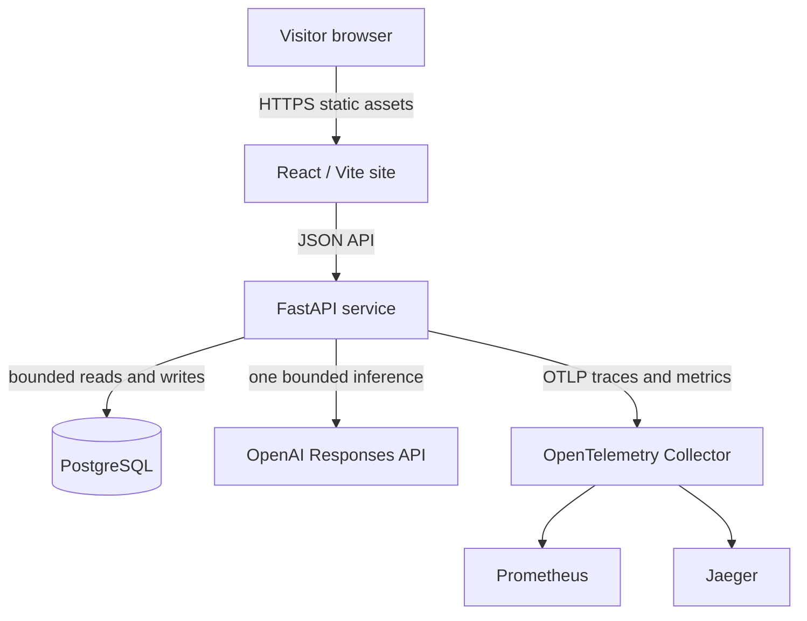

# Architecture

**Status:** Step 1 blueprint  
**Reviewed:** 2026-11-22

## Selected stack

| Area | Selection | Reason |
|---|---|---|
| Web | React + TypeScript + Vite; static build; accessible SVG/CSS for timeline, charts, and topology. | A small client-rendered public demo does not need server rendering. Vite produces static assets suitable for a CDN, keeping the visitor site independent of API compute. Add only focused visualization dependencies if the first implementation cannot meet accessibility and interaction needs. |
| API | Python 3 + FastAPI + Pydantic; SQLAlchemy and Alembic for database access/schema changes. | Typed request and response contracts, a direct fit for Python evaluation tooling, and a small monolithic service instead of a distributed agent platform. |
| Database | PostgreSQL. | Relational keys protect incident/evidence relationships; JSONB is reserved for flexible, versioned attributes and validated model output. Stable telemetry facts remain queryable columns. |
| Incident telemetry | Versioned, deterministic synthetic OpenTelemetry-shaped metrics, logs, spans, timeline events, and dependency edges stored in PostgreSQL. | Reproducible public data; no customer system or collector credential required. The shape follows common OpenTelemetry signal concepts without requiring a running demo environment. |
| App observability | OpenTelemetry SDK in the API, local OpenTelemetry Collector, Prometheus metrics, and Jaeger trace UI in the local Compose profile. | Observe API latency, errors, model-call timing, and request traces separately from the synthetic incident dataset. The Collector provides a vendor-neutral telemetry pipeline. |
| AI workflow | Small, explicit Python orchestration function; OpenAI Responses API; strict structured output schema. The application owns every data query and validation step. | Fixed one-pass workflow is easier to review, evaluate, and bound than an autonomous agent. Structured output supports rendering typed hypotheses, uncertainty, and evidence references. |
| Hosting | Static site on Netlify; FastAPI container and managed PostgreSQL on Render; server-side model credential in Render secret configuration. | Static/CDN delivery for the UI and managed hosting for the one dynamic service and database. Public replay does not depend on model-provider availability. |
| Source control / CI | Public GitHub repository with documentation, locked dependencies, CI checks, deployment configuration, and no secrets. | Keeps scenario definitions and evaluation method inspectable and makes the demo reproducible. The repository and CI are implemented; the current release and deployment status is recorded in the pre-deployment report. |

This Step 1 blueprint selected the stack before pinning versions. The implementation now records compatible dependencies in the backend and frontend lockfiles and READMEs.

## System components



The fixture evidence path is PostgreSQL → FastAPI → browser. Only the live-analysis route calls the model provider. Operational OpenTelemetry signals describe Incident Atlas itself; incident fixtures displayed in the UI are separate synthetic records in PostgreSQL.

## Investigation workflow

The live workflow is deliberately bounded and does not allow the model to execute tools:

1. Validate the incident ID, requested mode, idempotency key, request size, and public rate limit.
2. Load the incident, service map, timeline, and a fixed evidence query pack for the scenario's defined window. Queries are parameterized, read-only, indexed, and capped by row count and time range. A live run creates an immutable evidence snapshot and SHA-256 digest.
3. Apply a deterministic rules baseline to the same evidence snapshot. Keep its result as a separately labeled comparator; do not feed hidden ground-truth labels to the model.
4. Submit a compact, normalized evidence packet and a strict JSON Schema to the configured OpenAI Responses API model. The prompt tells the model that records may contain misleading text, that evidence is data rather than instructions, and that causes must remain hypotheses.
5. Validate the provider response against both the schema and business rules: supported hypothesis count, allowed enums, maximum text lengths, and evidence IDs that exist in the snapshot. Reject a response with unknown references or incomplete/refusal status; do not repair it by inventing evidence.
6. Persist the report with model ID, prompt/schema versions, snapshot hash, token usage, timing, and status. Persist no hidden reasoning trace. Return an API response with stable evidence links and a visible uncertainty note.
7. A separate, explicit approval endpoint for either a saved live report or stored replay verifies that the selected proposal belongs to that result, requires a simulation acknowledgment, and appends a `simulation_only` approval record. It has no executor, credentials, or outbound integration.

The result is a set of hypotheses, not a root-cause verdict. Confidence is displayed as a qualitative level plus a brief uncertainty statement; any optional 0–1 model score is labeled as an uncalibrated ranking aid and is not described as a probability.

```mermaid
sequenceDiagram
  actor Visitor
  participant UI as Web UI
  participant API as FastAPI
  participant DB as PostgreSQL
  participant AI as Model API
  Visitor->>UI: Choose Run live AI investigation
  UI->>API: POST investigation (incident ID)
  API->>DB: Load bounded fixture evidence
  DB-->>API: Evidence rows and source IDs
  API->>API: Build immutable snapshot and rules baseline
  API->>AI: One structured inference request
  AI-->>API: Hypotheses and evidence IDs
  API->>API: Validate schema and every evidence reference
  API->>DB: Persist report, snapshot hash, and usage
  API-->>UI: Live AI result with uncertainty
  Visitor->>UI: Confirm simulated mitigation
  UI->>API: POST simulation approval
  API->>DB: Append simulation-only audit record
  API-->>UI: Simulation recorded; no system changed
```

## Read-only tool and evidence limits

The model receives no database connection, SQL, arbitrary function-calling capability, shell, browser, OTLP endpoint, production credentials, or remediation tool. The backend uses named functions for a finite set of fixture reads: `get_incident_context`, `get_timeline_window`, `get_metric_series`, `get_trace_summaries`, and `get_log_events`. These are ordinary server-owned queries, not model-executable tools. Every function has a fixed query template, allowed filters, request deadline, and maximum result count. The model sees the evidence packet assembled by the server and returns evidence IDs only.

Evidence IDs resolve to immutable rows in a snapshot. Each evidence item carries source kind, source record ID, service, event time, fixture version, and display summary. The API rejects links to non-existent snapshot evidence. Hypotheses include at least one supporting or contradicting reference when available; an uncertainty statement is mandatory even when evidence appears strong.

## Failure and timeout behavior

- PostgreSQL query budget: 2 seconds total, maximum 500 input records per signal family, fixed 15-minute incident window.
- Model connect timeout: 2 seconds; response timeout: 12 seconds; one attempt; no automatic retry that could double-bill.
- Overall live request deadline: 18 seconds. Persist a failed status and safe error category when possible; return a request ID and tell the visitor to open a replay.
- Missing model configuration, provider error, refusal, incomplete structured output, invalid evidence reference, or response schema violation yields an explicit failed live run and no replay substitution.
- Replay endpoint reads a stored fixture result and remains independent of the provider.

## Implementation boundary

Step 1 produces documents only. Step 2 implements the backend contract and scenario loaders. Frontend work, deployment resources, and actual CI wiring remain later backlog items. See [implementation backlog](implementation-backlog.md).

## Reference documentation consulted

- [Vite guide](https://vite.dev/guide/) and [production build](https://vite.dev/guide/build) describe a static build suitable for static hosting.
- [FastAPI documentation](https://fastapi.tiangolo.com/) for typed API/service implementation.
- [PostgreSQL JSON types](https://www.postgresql.org/docs/current/datatype-json.html) for the limited flexible attributes fields.
- [OpenTelemetry Collector](https://opentelemetry.io/docs/collector/) for the local vendor-neutral telemetry pipeline.
- [OpenAI Responses API](https://developers.openai.com/api/reference/responses/overview) and [Structured Outputs](https://developers.openai.com/api/docs/guides/structured-outputs?api-mode=responses) for one-pass, typed model output. The app still validates refusals, incomplete responses, and domain constraints.
