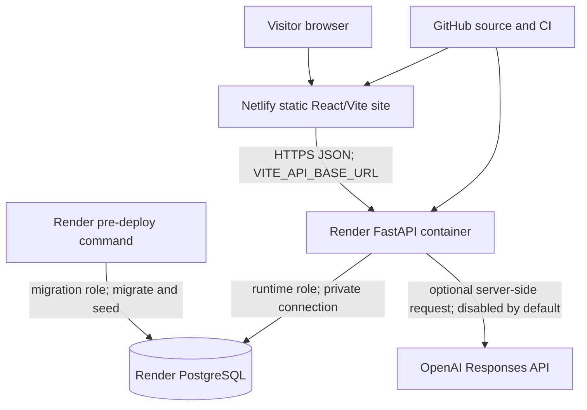

# Deployment plan

**Target architecture:** GitHub → Netlify static site + Render FastAPI/PostgreSQL.
**Current state:** configuration and CI checks are prepared; no public Incident Atlas services have been provisioned. See the [pre-deployment release report](predeployment-release-report.md) for the exact open gates.

## Local Docker Compose

From the repository root:

```bash
docker compose up --build
```

Compose starts PostgreSQL 17, waits for readiness, and runs a one-shot `bootstrap` container. That command applies migrations and idempotently seeds runtime incidents and replays. FastAPI then starts as a separate service; it does not run migrations on application startup. The Vite service starts after API readiness at `http://localhost:5173`; API health is at `http://localhost:8000/readyz`. Live AI is off by default. A public replay and simulated approval work without a model credential.

Local development uses the PostgreSQL owner role for simplicity. This is not the production permission model.

## Production topology



The API image includes `data/incidents/` only. `.dockerignore` excludes `data/evaluation/` and answer-key files; CI checks the built image filesystem. Local development and CI retain evaluation files in the source checkout.

## Required production configuration

Configure these values only after a hosting budget and account access are approved:

| Setting | Service | Required value / boundary |
|---|---|---|
| `VITE_API_BASE_URL` | Netlify build environment | Public API HTTPS origin plus exactly `/api/v1`, e.g. `https://<Render API hostname>/api/v1`. The production URL check rejects unset, relative, HTTP, wrong-path, credential, query, or fragment values before build. |
| `PUBLIC_SITE_ORIGIN` | Render API | The exact Netlify HTTPS origin with no path, such as `https://<site>.netlify.app`. |
| `CORS_ALLOWED_ORIGINS` | Render API | Exactly the same single value as `PUBLIC_SITE_ORIGIN`; production settings reject a mismatch or extra origins. |
| `DATABASE_URL` | Render API runtime | PostgreSQL URL authenticated as `incident_atlas_runtime`; `postgresql://` is normalized to `postgresql+psycopg://`. |
| `MIGRATION_DATABASE_URL` | Render pre-deploy | Render database owner/migration URL. It is used only by the one-shot `deploy-bootstrap` command. |
| `RUNTIME_DB_PASSWORD` | Render pre-deploy | Strong random password for the restricted runtime role. It is stripped before the API process starts. |
| `TRUSTED_PROXY_CIDRS` | Render API | CIDRs verified for the direct ingress proxy path. Do not use guessed private ranges or a wildcard. `X-Forwarded-For` is ignored unless the socket peer belongs to this allowlist. |
| `RATE_LIMIT_HMAC_KEY` | Render API secret | Random secret used to hash source addresses; raw addresses are not stored. |
| `RATE_LIMIT_ENABLED` | Render API | `true`. Required for live analysis. |
| `RATE_LIVE_GLOBAL_RUNS` / `RATE_LIVE_GLOBAL_WINDOW_SECONDS` | Render API | Shared PostgreSQL-backed call budget across all visitors and instances; initial config is five requests per 24 hours. |
| `LIVE_ANALYSIS_ENABLED` | Render API | `false` until the proxy configuration and global cap are deployed and a genuine provider request has been verified. |
| `OPENAI_API_KEY` | Render API secret, only if enabled | Server-side credential only. Never a `VITE_` variable and never present in the browser bundle. |

The Render Blueprint intentionally leaves the API URL, site origin, CORS origin, runtime database URL/password, and trusted proxy CIDRs for account-specific configuration. No hostname or proxy range is guessed in the repository. The API refuses to start in production if `PUBLIC_SITE_ORIGIN` and CORS do not match exactly or the runtime database URL uses the owner role.

### Database roles and deploy sequence

Render's `preDeployCommand` runs `uv run python -m incident_atlas.cli deploy-bootstrap`. It connects using `MIGRATION_DATABASE_URL`, creates or rotates the `incident_atlas_runtime` login, applies migrations, and seeds only runtime fixtures. It then grants the runtime role application-table access while revoking access to the `evaluation` schema, object creation in `public`, and changes to `public.alembic_version`. The API receives only `DATABASE_URL` for `incident_atlas_runtime`; `docker-start.sh` removes migration credentials from its environment before launching Uvicorn. A PostgreSQL integration test checks the actual grants, and CI runs the built image through this deploy/startup path.

The migration URL must be a database owner/migration connection with permission to create roles and apply migrations. `RUNTIME_DB_PASSWORD` is available to the pre-deploy command because Render supplies the service environment there; the API start script removes it before starting the request process. Do not use the runtime URL to run migrations.

## CI and release procedure

GitHub Actions runs:

1. PostgreSQL 17 migrations, repeated seed and manifest comparisons, backend integration tests, lint, dependency audit, and both rules evaluation reports. The tests use Render-shaped `postgresql://` URLs.
2. Frontend integration tests, typecheck, fail-closed API URL checks, production build against a reserved `.invalid` test URL, and dependency audit.
3. API image build and runtime check with a disposable PostgreSQL service: production-shaped URLs, least-privilege bootstrap, readiness, stored replay provenance, evidence lookup, and persisted simulation approval.
4. Playwright against local CI PostgreSQL, FastAPI, and Vite; it captures desktop and mobile screenshots. These screenshots describe the local CI run, not a public deployment.

After approval of hosting spend and account access, configure the real exact URLs, deploy API and web from the same tested revision, check `/readyz`, then complete the no-key replay → evidence → acknowledged approval journey in desktop and mobile browsers. Keep live analysis off until the shared cap is effective and one genuine server-side provider request is recorded. Never create recurring hosted resources without an approved spending cap.

## Rollback and provenance

- If API behavior or live analysis is unhealthy, set `LIVE_ANALYSIS_ENABLED=false`; stored replays remain available.
- Deploy API and static web from the same tested commit. The API migration path is an explicit pre-deploy step; runtime startup never migrates.
- The incident corpus is project-authored deterministic synthetic data shaped like OpenTelemetry evidence. It is not imported from an OpenTelemetry Demo instance and does not represent production telemetry.
- The three base cases and nine derived variants are regression cases only. Report their measured rules baseline separately from mocked provider tests and any genuine live results.
- The shared daily model cap is a spending-control ceiling, not a billing account limit. Configure provider-side limits separately before enabling live inference.
