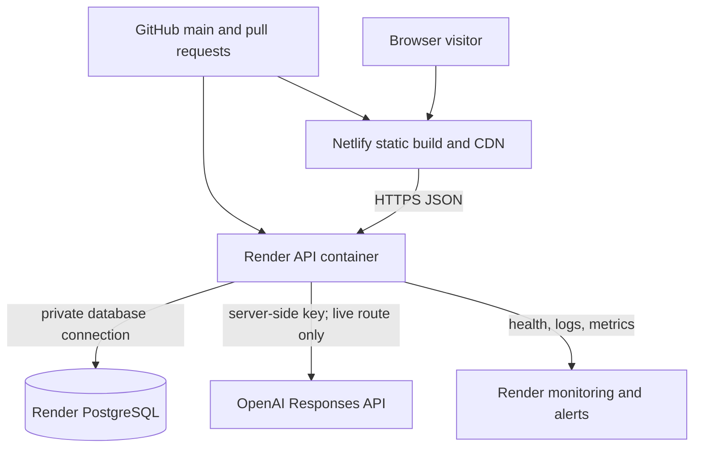

# Deployment plan

**Status:** Step 5 launch configuration prepared; external provisioning and end-to-end production checks remain gated.  
**Public plan:** GitHub → Netlify static site + Render API/PostgreSQL  
**Reviewed:** 2026-11-22

## Local Docker Compose topology

The checked-in `compose.yaml` defines:

| Service | Responsibility | Local port / profile |
|---|---|---|
| `web` | React/Vite development server. | `5173`; default profile. |
| `api` | FastAPI application, migrations, deterministic runtime seeding, and OpenAPI JSON. | `8000`; default profile. |
| `db` | PostgreSQL 17 with a named volume and readiness check. | `5432`; default profile. |

The application uses the seeded synthetic records for incident analysis. `docker compose up --build` starts PostgreSQL, waits for readiness, then the API container migrates and seeds before becoming healthy; the web container starts after API readiness. The live model path stays disabled unless a developer deliberately supplies a server-side `OPENAI_API_KEY` through an untracked local environment. Replay, telemetry, and simulated approval work without it. Compose itself has not been executed in the restricted runner because Docker is not installed.

## Public hosting plan

1. Create a public GitHub repository named `incident-atlas` after the blueprint is accepted. Keep scenario and label data synthetic. Add branch protection and CI checks before enabling production deploys.
2. Connect the `web/` static build to Netlify. Build command: `npm ci && npm run build`; publish directory: `web/dist`. Configure a history fallback for client routes. Set `VITE_API_BASE_URL` to the public API URL at build time; it contains no secret.
3. Deploy the root `Dockerfile` as an always-on Render web service. Configure TLS, health check `/readyz`, startup migrations and idempotent runtime seed, graceful shutdown, and exact CORS origins. Set the server model API key as a Render secret only when live investigation is intentionally enabled; never expose it in Vite variables, client bundles, build logs, or API responses.
4. Attach a managed Render PostgreSQL database in the same region. Use private networking, least-privilege runtime credentials, backups, and backward-compatible migrations. Render Free Postgres is temporary and unsuitable for a durable public demo.
5. Seed the three fixture scenarios and stored replay records as a deploy step that is safe to repeat. Verify health, catalogue, replay, live capability status, one live run, and a simulated approval before pointing the public site at the deployment.
6. Set usage alerts for hosting and model spend, retain health/error/request metrics, and document how to disable live analysis without disabling stored replay.

## Deployment configuration

| Variable | Where | Secret? | Purpose |
|---|---|---:|---|
| `VITE_API_BASE_URL` | Netlify build environment | No | Public API origin compiled into the static site. |
| `DATABASE_URL` | API host secret | Yes | PostgreSQL connection string. |
| `OPENAI_API_KEY` | API host secret | Yes | Provider credential; omit to disable live analysis. |
| `OPENAI_MODEL` | API host environment | No | Selected model name; persisted per run and pinned in deployment configuration. |
| `LIVE_ANALYSIS_ENABLED` | API host environment | No | Kill switch; false still leaves replay and read routes enabled. |
| `CORS_ALLOWED_ORIGINS` | API host environment | No | Exact production and preview origins allowed. |
| `RATE_LIMIT_HMAC_KEY` | API host secret | Yes | Rotating keyed hash for anonymous rate accounting; raw IP not persisted. |
| `OTEL_EXPORTER_OTLP_ENDPOINT` | API host environment | No | Optional operational trace/metric export endpoint. |

## Deployment and rollback

- Pull requests build web and API images, apply database migration checks to a disposable database, load fixtures, and run the documented CI suite before merge.
- Deploy API and web from the same Git SHA; display build SHA and fixture version in the methodology page.
- Run additive database migrations before code that depends on them. Seed changes are fixture-versioned and replay reports keep their producing version.
- If live analysis is unhealthy or over budget, set `LIVE_ANALYSIS_ENABLED=false`; do not disable replay. Roll back the API image independently from static UI if API compatibility is maintained.
- Keep a backup/restore runbook for hosted database and a scripted fixture reseed path. Do not rely on a free, expiring database for the durable public demo.

## Cost envelope and operations

Use an always-on low-resource API service plus managed PostgreSQL for a dependable public link. The 2026-11-22 check of Render's current public pricing lists the low-end always-on web service at **$7/month** and the smallest paid PostgreSQL compute at **$6/month**, approximately **$13/month** combined before storage, transfer, tax, and growth. Render Free web services sleep after 15 minutes idle, and Free Postgres expires after 30 days, has a 1 GB cap, and lacks backups; those limits do not meet this persistent public-demo plan. Netlify Free currently has a **300-credit monthly hard limit**; production deploys consume 15 credits, bandwidth consumes 20 credits/GB, and requests consume 2 credits/10,000. Free has no auto-recharge. Render/Netlify terms and actual account plan may differ and were not provisioned here. The $13/mo recurring hosting cost is a planning envelope, not an approved charge.

Model cost is variable. Keep replay at zero inference cost. Bound live evidence and output tokens, record actual input/output usage per run, and configure a low monthly provider budget/alert. The evaluation plan gives the per-run cost equation and initial public quota; re-check the provider price page at implementation and launch.

## Reference documentation consulted

- [Vite static deployment](https://vite.dev/guide/static-deploy) and [production builds](https://vite.dev/guide/build).
- [Render web services](https://render.com/docs/web-services), [managed PostgreSQL](https://render.com/docs/postgresql), [free-tier limits](https://render.com/docs/free), [Blueprint spec](https://render.com/docs/blueprint-spec), and [current pricing](https://render.com/pricing) (checked 2026-11-22).
- [Netlify plans and usage](https://www.netlify.com/pricing/) and [credit-based plan details](https://docs.netlify.com/manage/accounts-and-billing/billing/billing-for-credit-based-plans/credit-based-pricing-plans/) (checked 2026-11-22).
- [OpenAI API pricing](https://developers.openai.com/api/docs/pricing).
