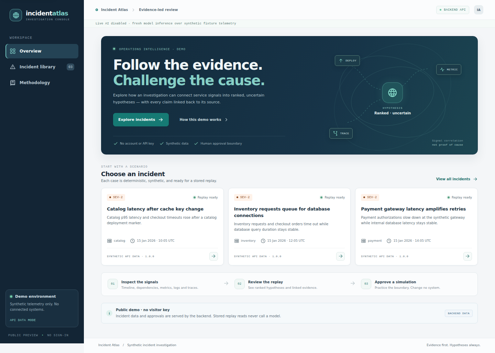
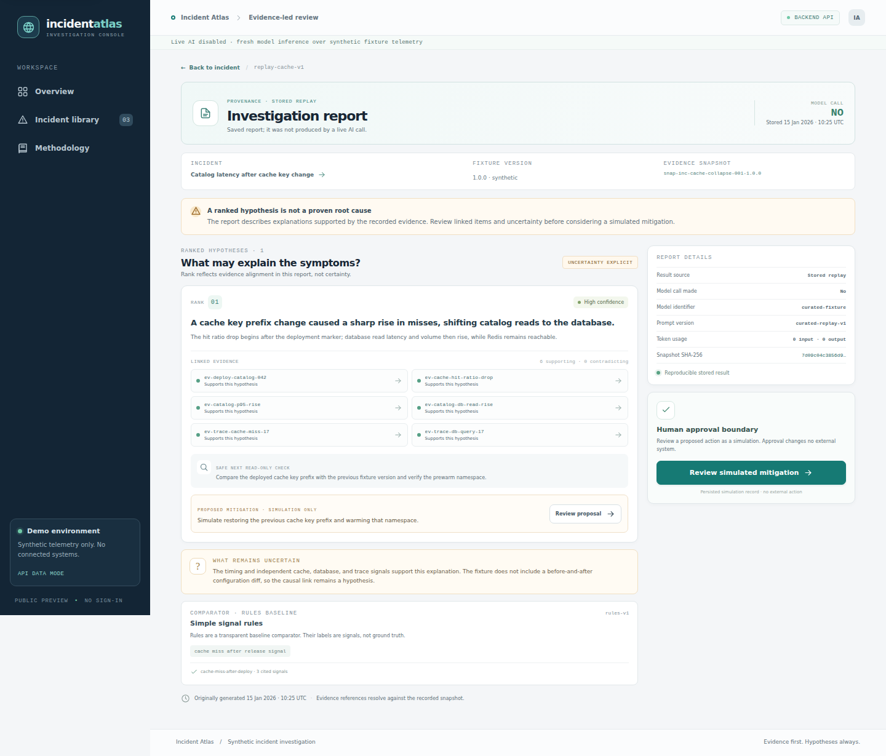
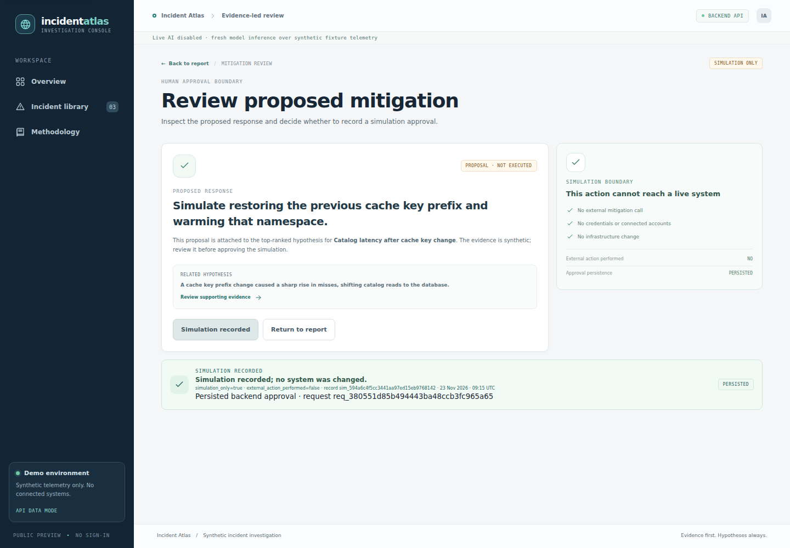

# Incident Atlas — portfolio case study

## Make incident reasoning reviewable

Incident Atlas is a public-facing incident investigation demo built around a concrete visitor path: choose a synthetic incident, inspect its timeline and service graph, read metrics/logs/traces, open a stored report, trace each citation to a snapshot record, and approve a simulation. It requires no account or visitor model key. Root causes remain hypotheses, and the approval endpoint never changes another system.

## Product and architecture

The browser UI uses React, Vite, and TypeScript. FastAPI serves the versioned API and PostgreSQL stores incidents, evidence snapshots, replay reports, investigations, approvals, and audit records. Alembic migrations and deterministic fixture seeding run as a separate deployment step. The API container omits the evaluation labels and runs as a non-root user with a limited database role.

Evidence is bounded to immutable snapshots. Reports record provenance and must cite evidence inside their snapshot. The optional model path is server-side and has no read/write tools; provider output is schema-checked and citation IDs are resolved before a result is shown. Public configuration keeps live AI disabled. A database-backed global request cap and explicit proxy trust configuration must be verified before turning it on.

Stored replay is the no-key path. Its provenance says `stored_replay` and `model_call_made=false`; opening it never calls a provider. Approval requires an acknowledgment and persists `simulation_only=true` and `external_action_performed=false`.

## Evaluation and limitations

The incident evidence is authored deterministic synthetic data shaped like OpenTelemetry records, not an import from OpenTelemetry Demo or real production telemetry. The project contains three base labels plus nine derived regression cases, including ambiguous expected-abstain cases. After correcting missing citation selection, the rules baseline measured 1.0000 top-1, MRR, and expected-support recall on the three base cases; the nine-case synthetic regression set measured 1.0000 labeled top-1, MRR, expected-support recall, and abstention accuracy. The original 0.5222 support-recall measurement remains recorded in the Step 5/6 history. These tiny fixture results are regression checks, not real-world incident accuracy. No genuine live model result has been verified; provider test coverage is mocked.

## Browser screenshots

The following screenshots are captured by the CI browser run against the local Vite site and local FastAPI/PostgreSQL services seeded with the synthetic scenarios. They show CI/local behavior only; no public deployment is implied.

_Desktop dashboard — local CI app, synthetic fixture catalogue._

_Incident detail — local CI API data, with metrics, logs, and traces available for inspection._

_Stored replay — local CI API response, explicitly labeled as a replay rather than live AI._

_Approval — local CI API response persisted with simulation-only fields._

_Mobile dashboard — 390 px viewport in the local CI browser run._

## Release status

Source: [GitHub repository](https://github.com/shaviJayasingha/incident-atlas). The current release has CI and local container checks, but the Netlify site, Render API, and production database have not been provisioned. There is no public demo URL. Deployment requires an approved hosting spending cap and account access; live AI additionally requires proxy-range verification and a genuine server-side provider request. Current evidence and exact gates are in the [pre-deployment release report](predeployment-release-report.md).
