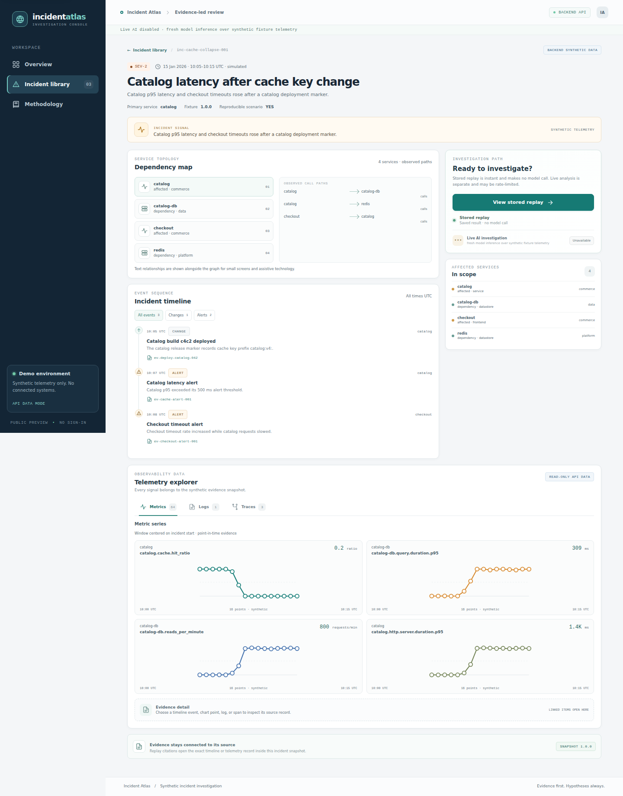
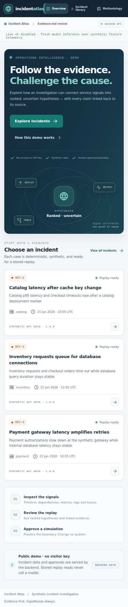

# Incident Atlas — portfolio case study

## Make incident reasoning reviewable

Incident Atlas is a no-sign-in incident investigation product prepared for a public demo. Its visitor path is concrete: choose a synthetic incident, inspect its timeline and service graph, read metrics/logs/traces, open a stored report, trace each citation to a snapshot record, and approve a simulation. It requires no visitor model key. Root causes remain hypotheses, and the approval endpoint never changes another system.

## Product and architecture

The browser UI uses React, Vite, and TypeScript. FastAPI serves the versioned API and PostgreSQL stores incidents, evidence snapshots, replay reports, investigations, approvals, and audit records. Alembic migrations and deterministic fixture seeding run as a separate deployment step. The API container omits the evaluation files and runs as a non-root user with table-specific database grants. The runtime role can update only investigation completion, error, usage, provider-request, and uncertainty fields; it cannot mutate seeded incidents, replay reports, immutable evidence, hypotheses, or approvals.

Evidence is bounded to immutable snapshots. Reports record provenance and must cite evidence inside their snapshot. The optional model path is server-side and has no read/write tools; provider output is schema-checked and citation IDs are resolved before a result is shown. Public configuration keeps live AI disabled. A database-backed global request cap and explicit proxy trust configuration must be verified before turning it on.

Stored replay is the no-key path. Its provenance says `stored_replay` and `model_call_made=false`; opening it never calls a provider. Approval requires an acknowledgment and persists `simulation_only=true` and `external_action_performed=false`.

## Evaluation and limitations

The incident evidence is authored deterministic synthetic data shaped like OpenTelemetry records, not an import from OpenTelemetry Demo or real production telemetry. The offline evaluation contains three base incidents, six derived variants, and three independent authored cases (12 total, with eight positive labels and four expected-abstain labels). GitHub Actions run #27 measured 1.0000 labeled top-1, MRR, expected-support recall, abstention accuracy, and overall decision accuracy on this fixed synthetic set; its SHA-256 is `65f6949e8c0c0d2f258fd65c2760591b2ff7b38fbb1edeb38cc3dc16cbac1527`. The original 0.5222 support-recall measurement is historical and is preserved in the Step 5/6 reports. These small regression results are not real-world incident accuracy. An OTLP/JSON trace and metric adapter is implemented, but no OpenTelemetry Demo capture was imported or scored. No genuine live model result has been verified; provider test coverage is mocked.

The release-candidate application revision is [`8f7b31fbceb34ec45724916b0dd493f99c68bc80`](https://github.com/shaviJayasingha/incident-atlas/commit/8f7b31fbceb34ec45724916b0dd493f99c68bc80), in [PR #5](https://github.com/shaviJayasingha/incident-atlas/pull/5). [Run #27](https://github.com/shaviJayasingha/incident-atlas/actions/runs/45145232854) passed 65 PostgreSQL-backed backend tests, 13 frontend tests, typecheck, build, dependency audits, migrations and repeated seeding, API container runtime smoke, desktop and mobile replay including every citation, approval restoration after reload, separate same-IP browser approval, and release ZIP validation. These are CI/local-app results, not public deployment evidence.

## Browser screenshots

The following screenshots are captured by [CI run #27](https://github.com/shaviJayasingha/incident-atlas/actions/runs/45145232854) against the local Vite site and local FastAPI/PostgreSQL services seeded with synthetic scenarios. They show CI/local behavior only; no public deployment is implied. The matching screenshot artifact is retained with the CI run for 14 days.

_Desktop dashboard — local CI app, synthetic fixture catalogue._

_Incident detail — local CI API data, with metrics, logs, and traces available for inspection._

_Stored replay — local CI API response, explicitly labeled as a replay rather than live AI._

_Approval — local CI API response persisted with simulation-only fields._

_Mobile dashboard — 390 px viewport in the local CI browser run._

## Release status

Source: [GitHub repository](https://github.com/shaviJayasingha/incident-atlas). The code has CI checks, including a container runtime exercise, but the Netlify site, Render API, and production database have not been provisioned. There is no public demo URL. Deployment requires an approved hosting spending cap and account access; live AI additionally requires proxy-range verification and a genuine server-side provider request. Current evidence and exact gates are in the [pre-deployment release report](predeployment-release-report.md).

The repository currently has no license file; see the [owner decision note](licensing-decision.md). No license was selected on the author's behalf.
